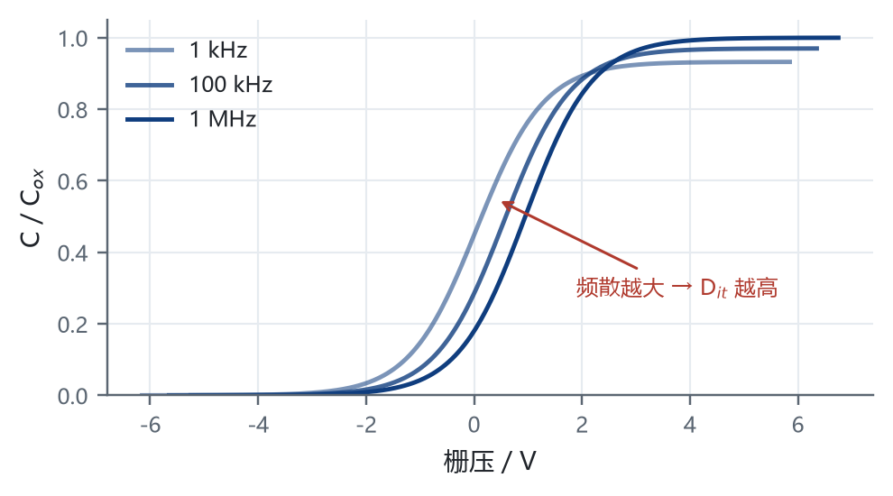
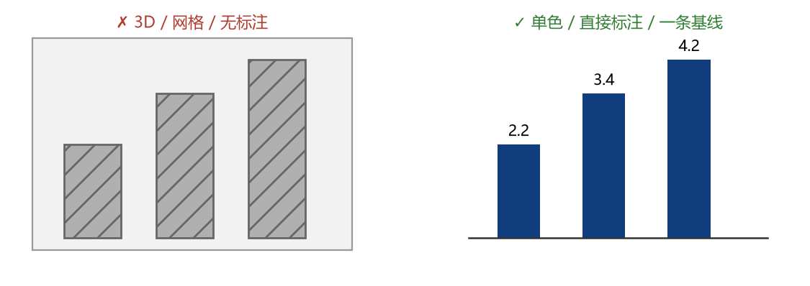

# Neutral Reveal

一个**中性可配置**的 Quarto reveal.js 格式扩展：封面、页眉三列（含可配置固定文字）、顶部圆点章节导航、PART 进度胶囊、CSS Grid 分格 panel（含格内二级细分）、卡片、公式、图号、讲者备注、fragment 与 `?print-pdf` 全部开箱可用。

默认外观不含任何真实机构名称或校徽，只有可替换的占位文字与中性几何徽标。作者 / 单位 / 标语 / **页眉文字** / 配色 / logo 全部由顶层 YAML 参数驱动，扩展自带的 `brand-header.lua` 会自动把它们注入 HTML 的 `<head>`；版式几何来自一套 Typst 蓝金主题，但**扩展本体不分发任何第三方 VI 资源**。当前版本 1.3.0（交互组件与静态内容共用一套自适应、格内媒体走 `data-media`，另附一份 40+ 屏的完整讲义示例）。

## 快速开始

**环境**：Quarto ≥ 1.8（本机 1.11.9 实测）。reveal.js 由 Quarto 内置，无需另装；看 HTML 不需要 Python / Chrome / TeX；中文依赖本机系统字体。

```bash
# 方式一：从零起一个 deck（推荐）
mkdir mydeck && cd mydeck
quarto use template --no-prompt RamanaVais/quarto-neutral-reveal
quarto render mydeck.qmd            # template.qmd 会被自动重命名为目录名

# 方式二：装进已有项目
quarto add RamanaVais/quarto-neutral-reveal
```

仓库地址：<https://github.com/RamanaVais/quarto-neutral-reveal>；固定到已发布版本可写 `RamanaVais/quarto-neutral-reveal@v1.3.0`。本地演练可用本地目录路径或 zip。  
`quarto add` **只安装 `_extensions/` 里的内容**，仓库根目录的 README / LICENSE / 渲染产物不会被带过去；LICENSE 请到仓库查看。

从 GitHub 安装时扩展落在 `_extensions/RamanaVais/neutral/`，用本地目录路径 / zip 安装时落在 `_extensions/neutral/`。两者格式名都是 `neutral-revealjs`，Quarto 会自动重写 CSS 与过滤器路径，**不需要改 qmd**。

`quarto use template` 必须在**目标目录内**执行（它只接受一个 `<target>` 参数）。

## 最小 qmd

```markdown
---
title: "我的汇报"
subtitle: "副标题"
author: "张三"
institute: "某某单位"
date: today
# brand-header: "某某单位 · 课程名"   # 可选：每页页眉右侧固定文字
embed-resources: true       # 顶层，-M 才能覆盖
html-math-method: mathml    # 顶层，-M 才能覆盖
format: neutral-revealjs
---

## 汇报提纲 {#outline}

::: {.nwpu-outline}

1. [第一章](#sec-01)

:::

# 第一章 {#sec-01}

<div class="nwpu-part">
<span class="part-meta" data-section="01" data-nav="第一章"></span>
<div class="part-watermark">01</div>
<div class="part-label">PART 01</div>
<div class="part-title">第一章</div>
<div class="part-rule"></div>
</div>

## 第一页

正文…… $E = mc^2$
```

完整可运行骨架见 `template.qmd`（含公式、fragment、讲者备注、panel 细分格、图号）。  
章节结构的固定写法与坑见 **[CONTRACT.md](CONTRACT.md)** —— 增删章节不需要改 JS/CSS，但 `#sec-NN` 与 `data-section` 必须一致。

## Header 注入与品牌参数化

所有品牌参数都是 **qmd 顶层的自定义 YAML 键**。扩展的 `brand-header.lua` 在渲染时读取它们，往 `<head>` 追加一段 `<style id="neutral-brand">`（颜色 / 图号 / logo）和一条 `<meta name="neutral-brand-header">`（页眉固定文字）；`chrome.html` 再读这条 meta，把文字放到每页页眉右侧、徽标左边。**没有任何品牌参数时不注入任何东西**，页眉也不会多出 DOM 节点，产物与旧版完全一致。

| 想改什么          | 顶层 YAML 键                                                                                                                      | 说明                                                                          |
| :------------ | :----------------------------------------------------------------------------------------------------------------------------- | :-------------------------------------------------------------------------- |
| 标题 / 副标题 / 日期 | `title` / `subtitle` / `date`                                                                                                  | 封面 Pandoc 变量                                                                |
| 汇报人 / 依托单位    | `author` / `institute`                                                                                                         | 封面，改了立即生效                                                                   |
| 封面顶部 tag      | `brand-tagline`                                                                                                                | 不写回退到 `institute`，再回退到中性占位                                                  |
| 封面底部色带        | `brand-unit`                                                                                                                   | 同上                                                                          |
| **页眉右侧固定文字**  | **`brand-header`**                                                                                                             | 单位 / 课程名等；删掉该行即不显示，建议 ≤ 20 字                                                |
| 主色 / 辅色 / 浅色系 | `brand-primary`、`brand-accent`、`brand-accent-soft`、`brand-primary-light`、`brand-primary-pale`、`brand-accent-light`、`brand-ink` | 对应 `:root` 的 `--brand-*` 令牌                                                 |
| 页眉与封面徽标       | `brand-logo-file`                                                                                                              | **推荐**：图片路径（相对项目根目录或绝对路径），构建期自动读文件转 data URI                                |
| 同上            | `brand-logo`                                                                                                                   | 直接给 CSS 值，如 `'url("data:image/png;base64,…")'`；与 `brand-logo-file` 同时写时后者优先 |
| 图号前缀          | `fig-label`                                                                                                                    | 默认「图 」；尾部空格会自动补齐                                                            |
| 页码 / 菜单       | `slide-number` / `menu` 等                                                                                                      | 在 `format:` 下覆盖扩展默认值                                                        |

一段可复制的配置：

```yaml
title: "我的汇报"
author: "张三"
institute: "某某大学"
brand-header: "某某大学 · 知识库工程"
brand-primary: "#0B4F4A"
brand-accent: "#B98A3E"
brand-logo-file: "assets/logo.png"
fig-label: "Figure "
embed-resources: true
html-math-method: mathml
format: neutral-revealjs
```

`template.qmd` 默认只启用 `brand-header: "YOUR ORGANIZATION · COURSE"` 作为活样例，其余参数以注释形式列出，取消注释即可生效。

**为什么 logo 要构建期内联**：`embed-resources` 按*工作目录*解析 CSS 里的相对 `url()`，CSS 一旦内联成 `data:` URI 就丢失路径基准；扩展在 `quarto add` 与 `quarto use template` 两种安装方式下目录也不同。所以 `neutral.css` 的默认徽标是内联 SVG data URI，而 `brand-logo-file` 由过滤器在构建期读文件并转成 data URI —— 单文件版与 live 版都保持 0 外链，**不需要随包分发图片目录**。支持 png / jpg / jpeg / svg / gif / webp；找不到文件时渲染日志会给出 `[brand-header] 找不到 …` 警告。可选 VI 皮肤接入模板见 `_extensions/neutral/skin-nwpu.css`（不含任何第三方标识）。

**高级：批量覆盖 CSS 变量** 仍可用 `include-in-header`。不要用 `format: ...: css: my.css`，那会替换掉扩展默认的 `neutral.css`：

```yaml
include-in-header:
  - text: |
      <style>
      :root { --card-stroke: #C9D3E2; --fig-label: "Fig. "; }
      </style>
```

注入层写在 `<head>` 末尾，优先级高于 `neutral.css`；两种写法可以叠加。

## 双产物

```bash
# 单文件自包含版：CSS / 图片 / MathML 全内联，拷 1 个文件、断网可看
quarto render mydeck.qmd -o mydeck.html

# live 现场版：S 键讲者视图、MathJax 公式、打印全功能
quarto render mydeck.qmd -M embed-resources:false -M html-math-method:mathjax -o mydeck-live.html
```

`-M` 覆盖的是**文档顶层** metadata；`embed-resources` 与 `html-math-method` 请始终写在 qmd 顶层，不要写进 `format:` 块。

|         | 单文件版            | live 版                                                                                      |
| :------ | :-------------- | :------------------------------------------------------------------------------------------ |
| 分发携带    | 仅 `mydeck.html` | `mydeck-live.html` + `mydeck_files/` + `figures/`（若有内容图）+ 扩展安装目录下的 `neutral.css` |
| 公式      | 构建期 MathML（离线）  | MathJax（需联网，jsdelivr CDN）                                                                   |
| 讲者视图    | 可能失效            | 正常                                                                                          |
| 改 CSS 后 | 必须重渲            | 改 `neutral.css` 刷新即可                                                                        |

live 版的外链主题样式指向**扩展安装目录**下的 `neutral.css`（Quarto 保留扩展目录的相对路径，不会复制进 `*_files/`）。路径随安装方式变化：从 GitHub 安装是 `_extensions/RamanaVais/neutral/neutral.css`，从本地目录 / zip 安装是 `_extensions/neutral/neutral.css`。以生成 HTML 里的 `<link href="...">` 为准，把对应目录一起带上；路径由 Quarto 自动重写，格式名与渲染行为不受影响。因为该 CSS 内已无相对路径图片，携带这一个文件即可，不需要额外 logo 资产。

其它：`?print-pdf` 导 PDF、`M` 键目录、`S` 键讲者视图、`.fragment` 动画、`::: {.notes}` 备注、圆点点击跳转都可用。

## 内容自适应：交互组件与静态内容

plotly / DT / Observable Plot 这类交互组件有个通病：尺寸写成固定像素就换不了版式，写成百分比又不会自己重排，最后只能靠 `overflow:hidden` 把溢出裁掉——看着没滚动条，其实内容缺了。静态内容（图片、表格、流程图）是另一个方向的老问题：要么按 `width` 写死撑破版式，要么缩得太小留一页空白。

1.1.0 起给一页内容包一层 `.fit`，高度由容器决定；**1.2.0 起图片、iframe/视频、普通表格、Mermaid/Graphviz 的 SVG 也走同一条高度链**。

```markdown
## 🔬 交互探索：退火窗口

::::::: {.fit}
:::::: columns
::: {.column width="58%"}
```{r}
#| echo: false
# 不要写 fig-height：高度由容器决定
plot_ly(...)
```
:::

::: {.column width="38%"}
::: defbox
**关键发现**
:::
:::
::::::
:::::::
```

运行时按类型重排：plotly 走 `Plotly.relayout` 按容器实测像素重算；DT 二分字号直到整表塞进可用宽高（**不用** `scrollY`）；OJS 的 SVG 补 `viewBox` 后等比 contain，永不裁切。`?print-pdf` 下 `.fit` 自己补回 reveal 清零的 `padding`，几何与屏幕版一致。

### 静态内容（1.2.0）

图片、表格、流程图写法一样，仍然不写任何尺寸：

```markdown
## 整页大图

:::: {.fit}

::::

## 左图右文

:::: {.fit}
::: {.columns}
::: {.column width="58%"}

:::
::: {.column width="38%"}
要点……
:::
:::
::::
```

| 内容 | 做法 |
| :-- | :-- |
| 图片 / `figure` | `.quarto-figure > figure > p` 整条包裹链变纵向 flex，`img` 100% + `object-fit:contain`，图题固定自然高 |
| iframe / 视频 | 同图片，`object-fit:contain`；不改 `src`、不加 `sandbox` |
| 普通 markdown 表格 | 复用 DT 的字号二分（9–18px），`display:table` 保住行列布局 |
| Mermaid / Graphviz / 手写 SVG | 补 `viewBox` 后等比 contain；额外清掉 mermaid 写的 `max-width` |

**刻意不接管**：宽度不足 30% 的小图标、200px 以下的 SVG、`figcaption` 里的图、**MathJax 公式**（它本身也是 `<svg>`）。某张图要保留原始尺寸，加 `data-fit-static="none"`。

| YAML 键 | 默认 | 作用 |
| :-- | :-- | :-- |
| `fit-mode` | `auto` | 设 `off` 关闭整份 deck 的自适应 |
| `fit-min-font` / `fit-max-font` | 9 / 18 | 数据表字号二分区间（px） |
| `fit-debug` | `false` | 控制台打印每页每个宿主的实测尺寸，并给未适配宿主加红框 |
| `fit-allow-scroll` | `false` | 全局允许滚动条（单块仍可用 `data-fit-allow-scroll`） |

**没有 `.fit` 标记时完全不干预**：不注册监听、不改 DOM、不注入样式，非交互 deck 的计算几何与 1.0.x 一致（实测 0 个 `.fit` 元素、0 个 `data-fit-host`）。

契约见 `_extensions/neutral/FIT-CONTRACT.md`（`CONTRACT.md` 保持不变）。审计脚本在配套技能 `quarto-reveal-fit` 里：

```bash
python scripts/fit_audit.py check --deck mydeck.html                 # .fit 页
python scripts/fit_audit.py check --deck mydeck.html --print-pdf
python scripts/fit_audit.py check --deck mydeck.html --panel         # panel 内的 data-media
```

它把**溢出**（内容比盒子大）、**裁切**（溢出且 `overflow:hidden`）、**越界**（内部 svg/table 超出宿主盒，PDF 里会被裁）分开判，失败项直接给出「需要 W×H > 可用 W×H」。`--panel` 另加一组格内断言：`data-media` 是否真的生效（`display:flex` / `flex-direction:column`）、格子有没有溢出、叶子是否 `object-fit:contain`、是否少于 91px、以及**整页**有没有压到页脚——panel 页即使没写 `data-media` 也会量，因为 panel 固定 380pt，标题 + 页眉 + 一段提示框就能把 720px 撑破。

> 版本历史见 [CHANGELOG.md](CHANGELOG.md)。

### 格内媒体：`data-media`（1.3.0）

`.fit` 管「整页自适应」，管不到 **panel 的一个格子**。格子高度是 Grid 轨道给的（4 宫格内容盒 175.75pt），cell 又是 `overflow:hidden` 的普通流——图一超高就被**静默裁掉**，不报错、无滚动条。1.3.0 给 cell / sub 加 `data-media`，格子变 flex 列，媒体吃满剩余高度：

```markdown
::::: {.panel data-mode="4" style="--px:52%;--py:50%"}

:::: {.cell data-area="a" data-media="img"}
<span class="card-title">图</span>

<figure class="nwpu-fig"><figcaption>不写 width / height</figcaption></figure>
::::

:::: {.cell data-area="b" data-media="video"}
<video src="figures/media/panel-demo.mp4" controls muted playsinline loop></video>
::::

:::: {.cell data-area="c" data-media="frame" style="--media-ar:4/3"}
<iframe src="figures/media/embed-demo.html"></iframe>
::::

:::: {.cell data-area="d" data-split="h" style="--sy:34%"}
::: {.sub}
<span class="card-title">半格也放得下</span>
:::

::: {.sub data-media="img"}

:::
::::

:::::
```

| 值 | 用于 | 高度由谁定 |
| :-- | :-- | :-- |
| `data-media="img"` | 图片 / `figure` / Markdown 隐式 figure | 宿主链 `flex:1 1 auto` → 叶子 100% + `object-fit:contain` |
| `data-media="video"` | `<video>`（**建议**整格，半格只有约 123px，控件占比过大） | 同上 |
| `data-media="frame"` | `<iframe>` | `width:100%` + `aspect-ratio:var(--media-ar, 16/9)` + `max-height:100%` |

三条边界：

- **必须带值**：Pandoc 把裸词 `{data-media}` 解析成 **class**，不是 attribute，写了不报错但不生效。
- **与 `data-split` 互斥**：一格要么「再分」（Grid）要么「放媒体」（flex），同时写时 split 胜出。
- **与 `.fit` 互斥**：1.3.0 起 `fit.html` 三处都跳过 `.panel`，不会给 cell 打 `data-fit-host`；反过来 `.fit` 里也别放 `.panel`。

`iframe` 只能保证「盒子不出界 + 比例可控」——`object-fit` 对嵌套浏览上下文不生效，页面内部该出滚动条还是出。**表格不要加 `data-media`**（`table` 必须 `display:table`）；**plotly / DT / OJS 不要放 panel**，要交互就拆掉 panel、整页用 `.fit`。

## 完整示例

`examples/lecture.qmd` 是一份真实交付过的 40+ 屏讲义（7 章、1319 行），用本扩展从零写到交付：封面 → 提纲 → PART 页 → 田字格与二级细分 → 格内图/视频/网页 → 代码组织 → 收尾。它同时是**回归样本**：`quarto render` 通过 + 章节契约校验通过，才算这一版没坏。

```bash
quarto render examples/lecture.qmd     # 仓库根的 _quarto.yml 让它找得到 _extensions/
```

用 `quarto use template` 起项目时 `examples/` 会一起复制过去（约 1.5 MB，含图与一段 5 秒演示视频），可以直接渲染、也可以整个删掉——`template.qmd` 才是起手骨架。语法速查看 `template.qmd` 与本文，`examples/` 负责「照着改」。

## 章节契约校验

扩展自带只读过滤器 `part-contract.lua`，每次渲染自动检查五处章号副本：

- 提纲 `href="#sec-NN"`、H1 锚点 `{#sec-NN}`、`.part-meta[data-section="NN"]`、`part-watermark`、`PART NN` 是否一致且连号；
- `data-nav` 与 `part-title` 的文案差异（页眉短名缩写属正常，仅作提示）。

不一致时输出 `(W)` 警告，例如把 `data-section` 改错会一次报出 H1、提纲、水印、PART 标签四项。这项检查是必要的：`#sec-NN` 与 `data-section` 不匹配时，点击提纲**不跳转也不报错**。过滤器返回 `nil`、不修改 AST，因此输出 DOM 与不装过滤器时完全一致，不需要重渲已有产物。

正常 deck 的输出形如：`[part-contract] OK：7 章，01–07 连号；提纲 / H1 / 水印 / PART 标签编号一致`。

## 排障索引

| 现象                             | 检查                                                                                                             |
| :----------------------------- | :------------------------------------------------------------------------------------------------------------- |
| 封面还是别人的名字                      | 改 `author` / `institute`；或设 `brand-tagline` / `brand-unit` 覆盖                                                  |
| 页眉固定文字不显示                      | `brand-header` 是否写在**文档顶层**（不能缩进到 `format:` 下）、是否被注释掉；`template.qmd` 默认带一行占位文字                                 |
| 页眉右侧文字挤到章节导航                   | 文字过长，建议 ≤ 20 字，或删掉 `brand-header`                                                                              |
| 页眉 / 封面徽标空白                    | 用 `brand-logo-file` 指到真实存在的文件；看渲染日志是否有 `[brand-header] 找不到 …`                                                  |
| 主色 / 图号前缀改了没生效                 | 参数是否写在顶层；`head` 里应出现 `<style id="neutral-brand">`                                                              |
| `Could not fetch resource ...` | 自定义 CSS 里出现了相对 `url()`；改用 `brand-logo-file` 或 data URI                                                         |
| 圆点 / 胶囊不出现                     | PART 页是否含 `.part-meta[data-section][data-nav]`；章标题是否为 H1                                                       |
| 提纲点击不跳转                        | `#sec-NN` 与 `data-section="NN"` 是否一致                                                                           |
| 出现空白页 / 当前页被推走                 | 是否把 `.reveal .slides section` 的 `position:absolute` 改掉了                                                        |
| `-M` 覆盖没生效                     | 两个键是否误写进了 `format:` 块                                                                                          |
| 不带文件名 `quarto render` 走了别的格式   | 显式指定 qmd 文件名；文档级 `format: neutral-revealjs` 才会生效                                                               |
| 公式不渲染 / 显示成原始 TeX              | live 版需联网（MathJax CDN）；单文件版需浏览器原生 MathML 支持，且个别复杂 TeX（如带 `\,` 的积分式）Pandoc 构建期无法转换，会回退成 TeX 文本，请改用简单公式或切 live 版 |
| 中文破折号导致分页                      | `——` 会被 Pandoc 转成 `---`，改用「：」或「，」                                                                              |
| 格子里图被裁掉一半                     | 有没有写 `data-media="img"`；格内别用 `{width=...}`（高度按宽反推，必超），改用 `<figure class="nwpu-fig">`                 |
| 格子里视频点不到播放键                   | 格子太矮：半格内容盒仅约 123px，控件占比过大；换整格或改 `data-mode`                                                          |
| 格子里 iframe 内部出滚动条               | 正常现象：`object-fit` 对嵌套浏览上下文无效，只保证盒与比例；调 `--media-ar` 或换内容                                                    |
| `data-media` 写了没反应                | 是否写成裸词 `{data-media}`（会被当 class）；是否同格又写了 `data-split`（split 胜出）                                          |

## Quarto 1.11.9 实测行为（维护依据）

| 项                                                              | 结论                                                                                                                                             |
| :------------------------------------------------------------- | :--------------------------------------------------------------------------------------------------------------------------------------------- |
| `contributes.format` / `formats`                               | 单数与复数**都生效**；本仓库采用单数，与 `quarto-touying-typst` 一致                                                                                               |
| `css` / `template-partials` / `include-after-body` / `filters` | 相对 `_extensions/neutral/` 解析成功；Quarto 把 `css` 重写为 `_extensions/neutral/neutral.css`；`filters: [part-contract.lua, brand-header.lua]` 两个过滤器互不干扰 |
| `pandoc.write(doc, 'html')`                                    | 在 Lua 过滤器中可用（demo deck 序列化约 68 KB），用于只读契约校验                                                                                                    |
| `Meta()` 追加 `header-includes`                                  | **`html` 与 `revealjs` 都生效**，`<style>` 确实落在 `<head>`；必须追加（`MetaList` 或转成 list），直接覆盖会丢掉 Quarto 自带资源                                              |
| Lua 读二进制 + base64                                              | 构建期可读 32 KB PNG 并生成 43 KB data URI，单文件版与 live 版都 0 外链                                                                                          |
| `pandoc.utils.stringify` 尾空格                                   | YAML `"Figure "` 的尾空格会被吃掉；`fig-label` 由注入层自动补一个分隔符                                                                                             |
| CSS 变量 → 浏览器                                                   | `--brand-*` 颜色、`--fig-label` 字符串、`--brand-logo` 的 `url()` 在 `background` / `content` 中均正确展开                                                    |
| 自定义 YAML 键                                                     | 透传为 Pandoc 变量，连字符（`brand-unit`）与下划线（`brand_unit`）写法均可                                                                                          |
| `$for(author)$` / `$for(institute)$`                           | 生效，标量字符串也能迭代一次                                                                                                                                 |
| `-M` 对扩展内默认值                                                   | **可以覆盖**（`embed-resources` / `html-math-method` 实测可切到 live 版）；但为兼容旧版本，仍建议把两键写在文档顶层                                                             |
| `var()` 在 `background` / `content`                             | 均正确展开，`--fig-label` 参数化成立                                                                                                                      |
| `quarto add <本地目录>`                                            | 只安装 `_extensions/`，根目录文件不带                                                                                                                     |
| `quarto use template --no-prompt <本地目录>`                       | 在目标目录内执行；`template.qmd` 自动重命名为目录名；生成项目可直接渲染                                                                                                    |
| `.quartoignore`                                                | 必需：根目录的 `*.html` / `*_files/` 等产物默认会被一起复制给使用者                                                                                                  |
| `quarto add RamanaVais/quarto-neutral-reveal`                    | 公开 GitHub 仓库安装成功，识别为 `Neutral Reveal 1.3.0 (format)`，扩展落在 `_extensions/RamanaVais/neutral/`                                                  |
| `quarto use template --no-prompt RamanaVais/quarto-neutral-reveal` | 自动装好扩展，复制 `CONTRACT.md` / `examples/` / 重命名后的 qmd；单文件版与 live 版均渲染通过，live 版 CSS 链到 `_extensions/RamanaVais/neutral/neutral.css`        |

## 已知限制

- 单文件版讲者视图可能失效；`chalkboard` 与 `embed-resources` 冲突，默认关闭。
- 字体使用系统字体栈，未随仓库分发字体文件；换机器字形与行高可能变化，进而影响 `--pt` 几何观感。
- 图号由 CSS 计数器生成，reveal 只渲染当前页时同章可能显示重复编号；正文不要写「见图 N」。
- `--pt` 与全部几何令牌绑定 1280×720，改画布尺寸等于重做版式。
- `data-split` 子格容量有限（横切半格内容盒约 75pt、三格每轨约 50pt），过长代码块 / 表格会被三层 `overflow:hidden` 静默裁切；放媒体就写 `data-media`，高度交给 CSS，不必手算数字。
- `data-media` 会 `!important` 覆盖作者写在媒体上的内联 `height`——这是设计意图（写了 `data-media` 就等于把高度交给 CSS），不是 bug。
- `data-media` 的 `:has()` 选择器要求 Chrome ≥ 105 / Safari ≥ 15.4；不支持时只有「裸 `<p></p>`」不再自动生长，Quarto 标准包裹仍由结构选择器覆盖。
- panel 内不要放 plotly / DT / OJS：它们按自身默认尺寸渲染，塞进 175pt 的格子必被裁。要交互就拆掉 panel、整页用 `.fit`。
- `brand-header` 文字与章节圆点导航共用页眉一行；章数多时右侧文字会压缩中间导航，建议缩短到 20 字以内或关闭。
- `html-math-method: mathml` 是构建期转换，少数复杂 TeX 会转换失败并回退成 TeX 文本（渲染时会有 `[WARNING] Could not convert TeX math`）；`template.qmd` 已改用可转换的简单公式，需要复杂公式请用 live 版的 MathJax。

## 目录结构

```
_quarto.yml                  只声明 project 类型，让 examples/ 能向上找到 _extensions/
_extensions/neutral/          ← quarto add 实际安装的全部内容
                              （从 GitHub 安装会多一层 owner：_extensions/RamanaVais/neutral/）
  _extension.yml              格式默认值
  neutral.css                 主题样式（A–P 段，H3 为格内媒体）
  fit.css                     内容自适应：高度链 + 静态内容 + 打印护栏
  fit.html                    自适应运行时（plotly / DT·表格 / OJS·SVG / 图片媒体）
  fit-options.lua             YAML 的 fit-* 参数 → <head> 的 meta
  title-slide.html            封面 Pandoc partial
  chrome.html                 页眉 / 圆点导航 / 胶囊注入脚本
  brand-header.lua            header 注入层：YAML 品牌参数 → <head> 的 style/meta
  part-contract.lua           章节数值契约只读校验
  skin-nwpu.css               可选 VI 皮肤接入模板（不含第三方标识）
  CONTRACT.md                 维护者视角的稳定契约清单
  FIT-CONTRACT.md             交互适配的独立契约（与 CONTRACT.md 分开维护）
template.qmd                  最小可运行骨架（quarto use template 的入口）
figures/                      template.qmd 用的 2 张图 + 1 段视频 + 1 个本地网页
examples/
  lecture.qmd                 40+ 屏完整讲义（回归样本）
  figures/                    讲义自己的 21 张图 + 视频 / 网页（可独立拷走）
  assets/nwpu-vi-logo.png     封面标识，仅作示例
  brand-overrides.css         配色覆盖示例
CONTRACT.md                   使用者视角的章节结构写法
CHANGELOG.md                  版本历史
.quartoignore                 排除渲染产物（根锚定，别用 `*.html`）
README.md  LICENSE
```

## 授权

代码采用 MIT，见 [LICENSE](LICENSE)。**校徽 / VI 标识、视觉规范与字体文件不在授权范围内**：扩展本体（`_extensions/`）不含任何第三方标识；`examples/assets/nwpu-vi-logo.png` 只为演示「`brand-logo-file` 能内联一张真实标识」，同样不在 MIT 授权范围内，替换成你自己的图即可，商用请自行取得授权。版式结构参考 `quarto-touying-typst`（Kazuharu Yanagimoto）及 Quarto / Pandoc / Reveal.js 上游项目，本扩展不附带也不修改其代码。

