<!--
  完整示例：一份 40+ 屏的真实讲义，用本扩展从零写到交付。
  渲染：quarto render examples/lecture.qmd   （仓库根的 _quarto.yml 让它找得到 _extensions/）
  它是「能跑通」的回归样本，不是 API 文档 —— 语法速查看 ../template.qmd 与 ../README.md。
  素材在 examples/figures/，封面标识在 examples/assets/（只作示例，不在 MIT 授权的署名范围内）。
-->
---
title: "Typst 幻灯工程化"
subtitle: "从踩坑到交付：Quarto + Touying + 西工大模板"
author: "冯老师"
institute: "西北工业大学 · 知识库工程组"
date: today
embed-resources: true
html-math-method: mathml
# 封面顶部 tag：精确还原原版字间空格；删掉本行即回退到 institute
brand-tagline: "西 北 工 业 大 学 · 知 识 库 工 程 组"
# 走扩展的 header 注入层恢复原校徽：构建期读文件内联，单文件版 / live 版都 0 外链
brand-logo-file: "assets/nwpu-vi-logo.png"
format: neutral-revealjs
---

## 汇 报 提 纲 {#outline}

::: {.nwpu-outline}

1. [起点：为什么换](#sec-01)
2. [版式：格式进模板](#sec-02)
3. [图文：别踩的坑](#sec-03)
4. [工程化：缓存与升级](#sec-04)
5. [互动与交付](#sec-05)
6. [实现解剖：代码怎么组织](#sec-06)
7. [收尾](#sec-07)
:::

## 本讲目标

::: {.columns}
::: {.column width="52%"}
**听完能带走三件事**

1. 一条能复现的管线：qmd → typ → PDF
2. 一套不返工的版式：内容与格式分离
3. 一张排坑清单：图宽、图号、版本、缓存

**课堂节奏**：讲 25 分钟，练 12 分钟，答疑 8 分钟。
:::

::: {.column width="44%"}
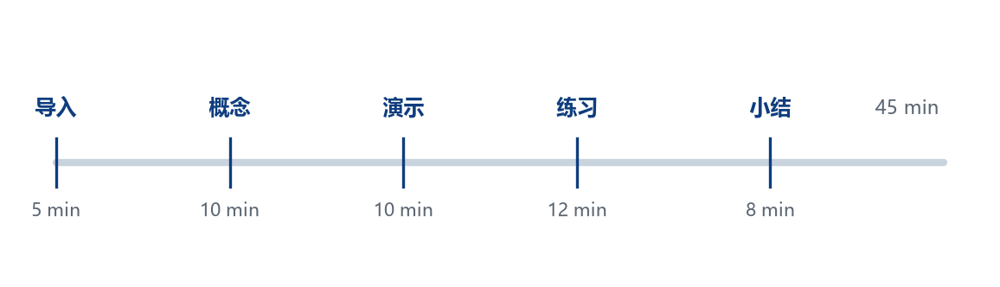{width=90%}
:::
:::

# 起点：为什么换 {#sec-01}

<div class="nwpu-part">
<span class="part-meta" data-section="01" data-nav="起点：为什么换"></span>
<div class="part-watermark">01</div>
<div class="part-label">PART 01</div>
<div class="part-title">起点：为什么换</div>
<div class="part-rule"></div>
</div>

## Beamer 的三个痛点

::: {.columns}
::: {.column width="52%"}
- 编译慢：30 页 deck 常要 10 秒以上，改标点也要等
- 报错难读：`.log` 全是宏展开，定位靠猜
- 依赖重：完整 TeX Live 数 GB，换机器就重装

**Typst 的对策**：毫秒级编译、人类可读报错、单文件编译器。
:::

::: {.column width="44%"}
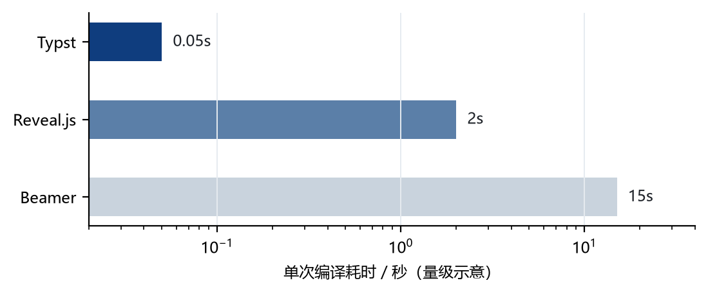{width=90%}
:::
:::

## 三条路线怎么选

::: {.columns}
::: {.column width="54%"}
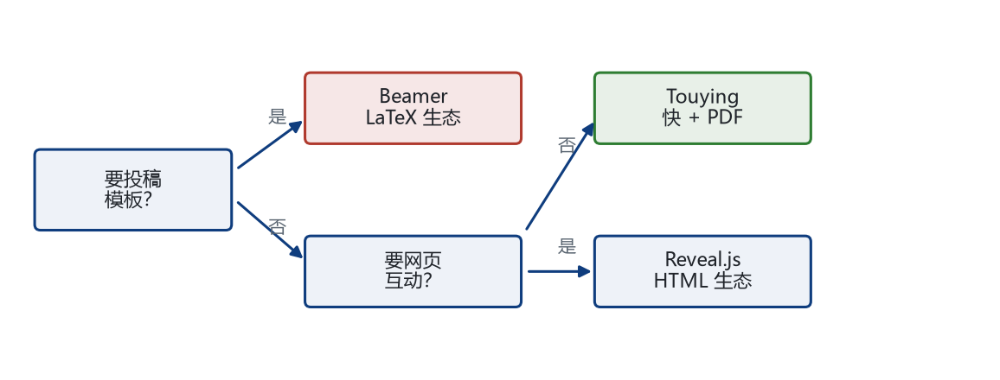{width=100%}
:::

::: {.column width="42%"}
**判据**

- 要投稿模板、期刊格式 → Beamer
- 要网页、真点击、在线分享 → Reveal.js
- 要快、要 PDF、要能改版 → Touying + Typst

**我们的场景**：课堂讲义 + PDF 交付，选第三条。
:::
:::

## 实际编译管线

::: {.columns}
::: {.column width="54%"}
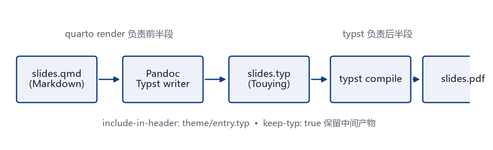{width=100%}
:::

::: {.column width="42%"}
**两条命令**

```bash
quarto render slides.qmd   # 前半段
typst compile slides.typ   # 后半段
```

- `keep-typ: true` 留下中间产物
- 版式入口：`include-in-header: theme/entry.typ`
- 调版式时直接编 `.typ`，跳过 Quarto
:::
:::

## 版本决定上限

::: {.columns}
::: {.column width="54%"}
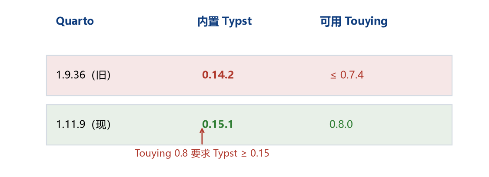{width=100%}
:::

::: {.column width="42%"}
**版本是一条链**

1. Quarto 决定内置 Typst
2. Typst 决定可用 Touying
3. Touying 决定主题 API

升级顺序只能从上往下，反过来会报 `package requires Typst 0.15`。
:::
:::

## 随堂一问

::: {.quiz}
<span class="q-tag">课堂提问</span>

<span class="card-title">Quarto 1.9.36 + Touying 0.8.0，能直接跑吗？</span>

- A. 能，Touying 向下兼容
- B. 不能，内置 Typst 0.14.2 太低
- C. 不能，缺主题包
:::

::: {.fragment}
::: {.defbox}
**答案 B。** Touying 0.8 要求 Typst ≥ 0.15；先升 Quarto 到 1.11（内置 0.15.1），再升 Touying。
:::
:::

# 版式：格式进模板 {#sec-02}

<div class="nwpu-part">
<span class="part-meta" data-section="02" data-nav="版式：格式进模板"></span>
<div class="part-watermark">02</div>
<div class="part-label">PART 02</div>
<div class="part-title">版式：格式进模板</div>
<div class="part-rule"></div>
</div>

## 模板只留两个旋钮

::: {.columns}
::: {.column width="48%"}
**正文只管内容**

- `slides.qmd`：正文 + 元数据
- `theme/entry.typ`：一行 import
- `_quarto.yml`：format 默认值

**版式只管 `CONFIG`**

- 页眉高度、导航字号
- 页脚金线、页码
- 配色 `primary` / `gold`
:::

::: {.column width="48%"}
```yaml
format:
  touying-typst:
    theme-typst: nwpu-frame
    theme-title-slide: nwpu-cover
    include-in-header: theme/entry.typ
    keep-typ: true
```

```typst
// theme/nwpu-theme.typ
#let CONFIG = (
  page: (margin-x: 2.5cm, ...),
  header: (title-size: 1.0em, ...),
  colors: (primary: rgb("#0F3D7E"), ...),
)
```
:::
:::

## 页眉解剖

::: {.columns}
::: {.column width="54%"}
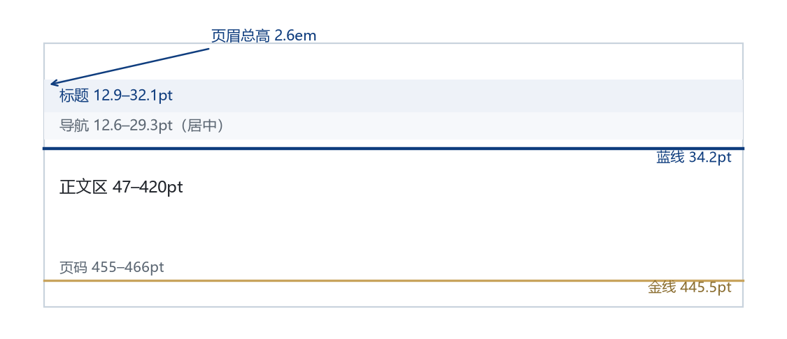{width=100%}
:::

::: {.column width="42%"}
- 标题行 12.9–32.1，单行才不顶出页面
- 导航 12.6–29.3，居中、按栏目分点
- 蓝线 34.2，同时是田字格的上边
- 正文 47–420，底边留到 420
- 金线 445.5，页码 455 起
:::
:::

## 页眉是怎么画的

::: {.columns}
::: {.column width="50%"}
```typst
#let nwpu-header(self) = {
  grid(
    columns: (auto, 1fr, auto),
    // 标题 | 导航 | 校徽
    align(left + bottom, text(
      size: CONFIG.header.title-size,
      utils.display-current-heading(..),
    )),
    align(center + bottom, nwpu-nav(self)),
    align(right + bottom, image(logo, ..)),
  )
  v(CONFIG.header.nav-gap + .22em)
  grid(inset: (x: ..),
    line(length: 100%, stroke: ..))
}
```
:::

::: {.column width="46%"}
**逐行看**

- `columns: (auto, 1fr, auto)`：标题列按内容取宽，才不会被导航挤成两行
- `display-current-heading` 取标题原文，不调用 `titlecase`，避开中文崩溃
- 第二条 `grid` 只画一条 100% 蓝线，它同时是田字格的上边
:::
:::

## 田字格与三格分法

::: {.columns}
::: {.column width="54%"}
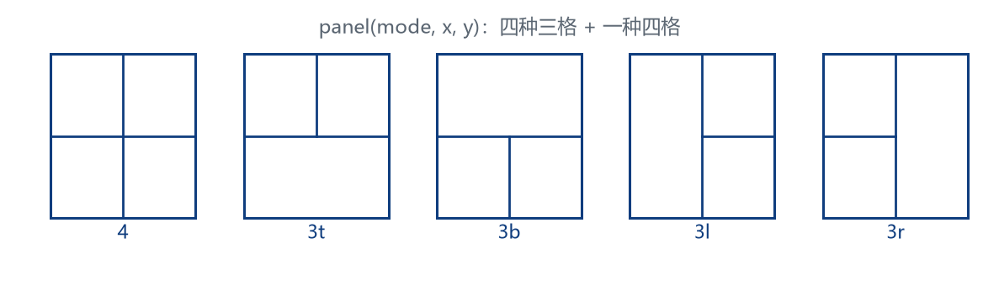{width=85%}
:::

::: {.column width="42%"}
**怎么用**

- `mode: "4"` 四宫格：图 + 三条要点
- `"3t"` 上两格：对比两个方案
- `"3b"` 下两格：总图 + 两条结论
- `"3l"` / `"3r"`：一侧通栏放图，另一侧分两段

`x / y` 是内部线位置，按内容分界调。
:::
:::

## panel 源码：两笔线

::: {.columns}
::: {.column width="50%"}
```typst
#let panel(mode: "4", x: 50%, y: 50%) = place(
  top + left, dx: -36.7pt, dy: -12.6pt,
  box(width: 0pt, height: 0pt, {
    let w = GRID-W; let h = GRID-H
    let st = 1.2pt + primary
    let v(p, y0, y1) = place(dx: p, dy: y0,
      line(angle: 90deg,
        length: y1 - y0, stroke: st))
    let hz(q, x0, x1) = place(dx: x0, dy: q,
      line(length: x1 - x0, stroke: st))
    v(0pt, 0pt, h); v(w, 0pt, h)
    hz(h, 0pt, w)
    if mode == "4" {
      v(x * w, 0pt, h)
      hz(y * h, 0pt, w)
    }
  }))
```
:::

::: {.column width="46%"}
**三个关键点**

- `place` 把坐标系原点挪到标题线左端，线才能和页眉对齐
- `box(0pt, 0pt)` 让线不占版面，内容仍按正常流排
- `mode` 分支只决定「竖线画到哪、横线画多长」，位置由 `x / y` 给
:::
:::

## 网页版补的一层：格内细分

::: {.columns}
::: {.column width="54%"}
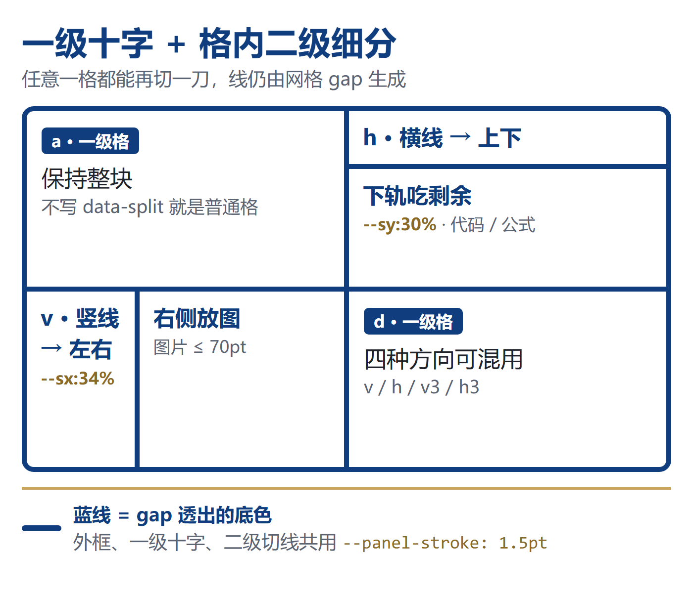{width=100%}
:::

::: {.column width="42%"}
**Typst 原版只切一级**

`panel(mode, x, y)` 画完十字就结束；一格要放「标题 + 代码」，只能把内容硬塞进同一格。

**三层冒号**

`panel` 5 → `cell` 4 → `sub` 3

**reveal 版的三条考虑**

1. **不画第二套线**：cell 也变 grid，`gap` 共用 `--panel-stroke`
2. **方向与比例分离**：`data-split` 管方向，`style` 管比例
3. **渐进增强**：不写 `data-split` 的格照旧，旧页零改动
:::
:::

::: {.notes}
这一段是网页版相对 Typst 版的增补，不属于原讲义主线。强调一点：一级十字线本来就是 CSS Grid 的 gap 透出蓝底得到的，二级沿用同一机制，所以没有新增任何绝对定位的画线代码。
:::

## 四种方向，一页看全

::::: {.panel data-mode="4" style="--px:50%;--py:50%"}

:::: {.cell data-area="a" data-split="v" style="--sx:34%"}

::: {.sub}
<span class="card-title">v · 一条竖线</span>

左右两块
:::

::: {.sub}
`grid-template-columns`

`--sx:34%` 定左轨
:::

::::

:::: {.cell data-area="b" data-split="h" style="--sy:30%"}

::: {.sub}
<span class="card-title">h · 一条横线</span>

上下两块
:::

::: {.sub}
`grid-template-rows`

上轨 `--sy:30%` 放小标题
:::

::::

:::: {.cell data-area="c" data-split="v3" style="--sx:25%;--sx2:35%"}

::: {.sub}
<span class="card-title">v3 · 三列</span>

25%
:::

::: {.sub}
35%
:::

::: {.sub}
40% 吃剩余
:::

::::

:::: {.cell data-area="d" data-split="h3"}

::: {.sub}
<span class="card-title">h3 · 三行</span>

不写 style
:::

::: {.sub}
默认 1/3
:::

::: {.sub}
默认 1/3 · 1/3
:::

::::

:::::

::: {.notes}
提醒术语：v 是竖线，切的是 columns，得到左右两块；h 是横线，切的是 rows，得到上下两块。三格版最后一轨恒为 minmax(0, 1fr)，所以写 --sx:25%;--sx2:35% 得到 25/35/40；不写 style 就是精确三等分。
:::

## 语法：5 / 4 / 3 三层冒号

::: {.columns}
::: {.column width="52%"}
````qmd
::::: {.panel data-mode="4" style="--px:50%;--py:50%"}

:::: {.cell data-area="b" data-split="h" style="--sy:30%"}

::: {.sub}
<span class="card-title">标题</span>
:::

::: {.sub}
这里放代码 / 公式 / 要点
:::

::::

:::::
````

**写法要点**：只给需要再分的那一格加 `data-split`，其余格保持 `:::: {.cell ...}` 不变。
:::

::: {.column width="44%"}
| 写法 | 作用 |
|:--|:--|
| `data-split="v"` | 竖线 → 左右 2 格 |
| `"h"` | 横线 → 上下 2 格 |
| `"v3"` / `"h3"` | 三列 / 三行 |
| `--sx` / `--sx2` | 竖分第 1 / 2 轨 |
| `--sy` / `--sy2` | 横分第 1 / 2 轨 |
| 不写 `style` | 精确等分 |

::: {.defbox}
**三条硬约束**：`.sub` 数等于轨道数；cell 必须是 panel 的直接子；panel 内不要套 `.columns`。
:::
:::
:::

::: {.notes}
冒号数按 Pandoc fenced div 的配对规则：层数越深冒号越多，全项目 panel 与 cell 已统一升到 5 和 4，子格用 3。比例用 style 自定义属性而不是 width 属性，因为 Quarto 会把 width 改写成 style="width:..."，而 style 原样透传。
:::

## CSS 里发生了什么

::: {.columns}
::: {.column width="52%"}
```css
.panel .cell[data-split] {
  display: grid;
  gap: var(--panel-stroke);  /* 蓝线 */
  padding: 0;
  background: var(--nwpu-blue);
}
.panel .cell[data-split="h"] {
  grid-template-rows:
    var(--sy, minmax(0, 1fr))
    minmax(0, 1fr);
}
.panel .cell[data-split] > .sub {
  background: #fff;
  padding: calc(6*var(--pt))
           calc(9*var(--pt));
}
```
:::

::: {.column width="44%"}
**四条实现考虑**

- **同构**：二级复用一级的 `gap`，线宽由 `--panel-stroke` 统一，不必定位画线
- **回退**：`var(--sy, minmax(0,1fr))`，百分比轨道不吃 `gap` 会差一条线宽
- **不叠加**：`.sub` 只补白底与 padding，不设 `font-size`、不加圆角
- **可扩展**：要三级时照此加 `.sub[data-split]` 即可

子格容量有限：横切半格内容盒约 75pt。纯文字要克制；放图/视频就写 `data-media`，高度交给 CSS，不必再手算 70pt（下一节讲）。
:::
:::

::: {.notes}
两个易踩的坑：一是 attr() 在网格轨道上不被 Chrome 解析，所以比例不能塞进 data-split 的属性值，否则 v:6/4 只能穷举选择器、三格无解；二是 .sub 若设 font-size 会与父级 .9em 相乘，字越分越小。圆角由外层 .panel 的 overflow:hidden 统一裁，给子格单独加圆角会在十字交叉处露蓝缝。
:::

## 格内媒体：三条高度链

::: {.columns}
::: {.column width="54%"}
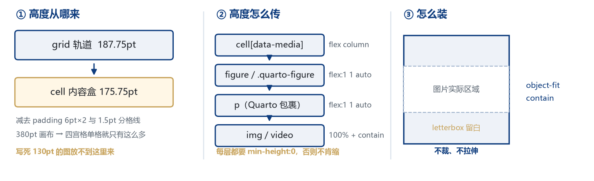{width=100%}
:::

::: {.column width="42%"}
**Markdown 图为什么不行**

- Pandoc 生成 `.quarto-figure > figure > p > img` 四层
- `max-height:150pt` 只认 `figure.nwpu-fig`，一层都不匹配
- `width:100%` 让高度由宽反推，格子多高它不管，超了就被裁

**老写法**

`height:calc(130*var(--pt))` 能对准，换个格子就得重算。

**`data-media` 只干一件事**

把剩余高度从轨道一路传到 `img`，末尾 `contain` 装箱。
:::
:::

::: {.notes}
三条链：① 轨道 187.75pt 给高度，减 padding 6pt×2 得内容盒 175.75pt；② cell 变 flex 列，figure / .quarto-figure / p 三层都 flex:1 1 auto 往下传；③ 叶子 100% + contain 装箱。
最关键的一条是每层都要 min-height:0。flex 子项默认 min-height:auto，永远不肯缩到内容高度以下，这才是「图撑出格子」的真正原因，而不是图太大。
这套办法与 fit.css 里给交互组件用的高度链完全同构，差别只在高度源：那边是 section 内容盒 1176×557.34，这边是 grid 轨道。也正因为高度源不同，两套不能混用。
:::

## 格内四种媒体

::::: {.panel data-mode="4" style="--px:50%;--py:50%"}

:::: {.cell data-area="a" data-media="img"}
<span class="card-title">图 · data-media="img"</span>

<figure class="nwpu-fig">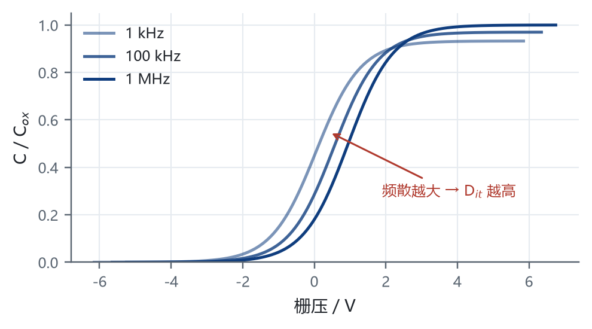<figcaption>不写 width / height</figcaption></figure>
::::

:::: {.cell data-area="b" data-media="video"}
<video src="figures/media/panel-demo.mp4" controls muted playsinline loop></video>
::::

:::: {.cell data-area="c" data-media="frame" style="--media-ar:16/10"}
<iframe src="figures/media/embed-demo.html" title="格内网页演示"></iframe>
::::

:::: {.cell data-area="d" data-split="h" style="--sy:30%"}
::: {.sub}
<span class="card-title">半格也能放</span>

`data-split` 再分，子格各挂 `data-media`。
:::

::: {.sub data-media="img"}
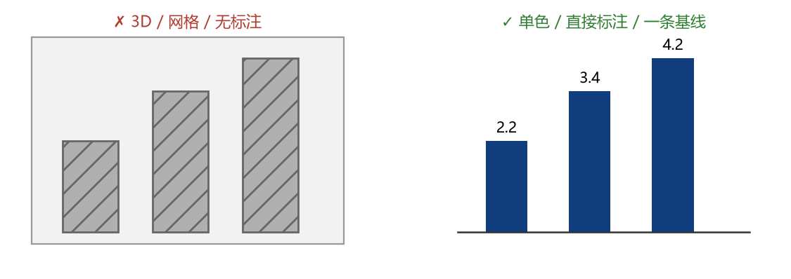
:::
::::

:::::

::: {.notes}
这一页是自指的：四个格子在演示「格子里能放什么」。
左上不写任何尺寸，图自己 contain 装箱；长图题也不会把图挤扁，因为 figcaption 是 flex:0 0 auto。原来的写法是写死 130pt，现在一个数字都不用。
右上是真视频，5 秒 254KB，H.264。控件条画在 video 元素自己的盒内（shadow DOM 的一部分），overflow:hidden 裁的是盒子，裁不到控件。真正要担心的是格子太矮时控件占比过大，半格只有约 123px，所以长视频用整格。
左下是本地 HTML 页面，时钟在走、按钮能点。iframe 是独立浏览上下文，Chrome 不按 object-fit 缩放它的内容：我们只保证盒子不出界、比例可控（--media-ar），页面内部按自己的 viewport 排版，该出滚动条还是出。这是 iframe 的物理上限，不要承诺 contain。
右下演示 data-media 也能挂在 .sub 上。注意 data-split 与 data-media 是互斥的：一格要么再分、要么放媒体。
:::

## 写法与坑

::: {.columns}
::: {.column width="50%"}
````qmd
:::: {.cell data-area="a" data-media="img"}
<figure class="nwpu-fig">
  
</figure>
::::

:::: {.cell data-area="b" data-media="video"}
<video src="figures/media/x.mp4"
       controls muted playsinline loop>
</video>
::::

:::: {.cell data-area="c" data-media="frame"}
<iframe src="figures/media/page.html">
</iframe>
::::
````

**三个值的差别只在叶子**

`img` / `video` 走 `contain`；`frame` 走 `aspect-ratio`，因为嵌套文档不吃 `object-fit`。
:::

::: {.column width="48%"}
| 内容 | 属性 | 高度谁管 |
|:--|:--|:--|
| 图 | `"img"` | CSS contain |
| 视频 | `"video"` | 同上 |
| 网页 | `"frame"` | aspect-ratio |
| 表格 | 不加 | 内容行数 |
| plotly | 不能放 | 拆 panel 用 `.fit` |

::: {.pitfall}
**四条边界**

- **必须带值**：裸词 `{data-media}` 会被 Pandoc 当成 class，不报错也不生效
- **一格一媒体**：flex 分的是剩余高度，两个媒体会互相抢
- **与 `data-split` 互斥**：同时写时 split 胜出
- **与 `.fit` 互斥**：1.3.0 起 `fit.html` 三处都跳过 `.panel`
:::
:::
:::

::: {.notes}
这张表是排障索引：图被裁查有没有写 data-media；视频点不到播放键查格子高度；iframe 内部出滚动条属正常；表格缺行只能减行；plotly 放 panel 必被裁。
最后一条边界最要紧。fit 和 panel 各自有一套高度源，混用就会出现「grid 被 flex 顶掉」这种最难查的排版事故：fit.html 会给宿主的 .closest('.cell') 打 data-fit-host，而 .reveal .slides section .fit .cell[data-fit-host] 的特异性是 0,5,0，压过 .panel .cell[data-split] 的 0,3,0，格内二级分栏就无声消失了。
所以 1.3.0 在 fit.html 的 push / ok / add 三处都加了 closest('.panel') 判空，命中即 return。
:::

## 互动组件

::::: {.panel data-mode="4" style="--px:50%;--py:50%"}

:::: {.cell data-area="a"}
<span class="card-title">quiz 提问卡</span>

- 课前测、随堂问
- 白底蓝框，底部自动「先想 30 秒」
- 答案翻页用 `. . .`
::::

:::: {.cell data-area="b"}
<span class="card-title">poll 投票卡</span>

- 左选项、右二维码
- 问卷星 / 自建表单
- 投完再翻页解读结果
::::

:::: {.cell data-area="c"}
<span class="card-title">pitfall 误区卡</span>

- 先摆错误认知
- 浅金底，和答案卡区分
- 适合「是不是越小越好」这类问题
::::

:::: {.cell data-area="d"}
<span class="card-title">defbox 要点卡</span>

- 定义、答案、一句话结论
- 浅蓝底，左竖条
- 和 quiz 配对使用
::::
:::::

# 图文：别踩的坑 {#sec-03}

<div class="nwpu-part">
<span class="part-meta" data-section="03" data-nav="图文：别踩的坑"></span>
<div class="part-watermark">03</div>
<div class="part-label">PART 03</div>
<div class="part-title">图文：别踩的坑</div>
<div class="part-rule"></div>
</div>

## 图宽怎么写

::: {.columns}
::: {.column width="52%"}
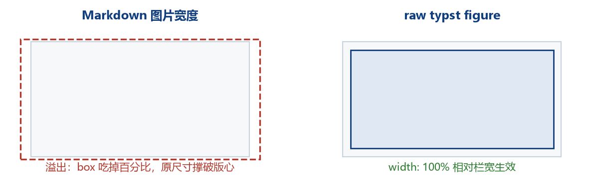{width=100%}
:::

::: {.column width="44%"}
**错误写法**

```markdown
{width=90%}
```

Pandoc 会包成 `#box(image(...))`，百分比按 box 自身宽度算，等于没生效。

**正确写法**

```typst
#figure(image("x.png", width: 100%), caption: [...])
```

在 reveal 里 Markdown 图片宽度**正常生效**。
:::
:::

## 图号为什么重复

::: {.columns}
::: {.column width="52%"}
{width=100%}
:::

::: {.column width="44%"}
**现象**

- 同一页 `. . .` 拆成两页
- 图在每页重排，计数器 +1
- 出现「图 7 / 图 7」

**处理**

- 动画只放无编号图的页面
- 或给图 `numbering: none`，手写图号
:::
:::

## 图表设计三条线

::: {.columns}
::: {.column width="52%"}
{width=100%}
:::

::: {.column width="44%"}
**课堂上要避免**

- 3D、阴影、花网格
- 图例离数据太远
- 只给颜色不给数值

**推荐**

- 单色系 + 直接标注
- 一条基线、一个结论
- 图题写「所以呢」，不写「如图所示」
:::
:::

## qmd 里的两种写法

::::: {.panel data-mode="4" style="--px:50%;--py:50%"}

:::: {.cell data-area="a"}
<span class="card-title">Markdown 负责结构</span>

- 分栏：`::: {.columns}` 加 `.column`
- 分步：整块 `. . .`
- 组件：`::: {.quiz}` 这类 div
::::

:::: {.cell data-area="b" data-split="h" style="--sy:30%"}

::: {.sub}
<span class="card-title">raw typst 负责精确</span>
:::

::: {.sub}
```typst
#figure(
  image("x.png", width: 100%),
  caption: [一句话结论],
)
```
:::

::::

:::: {.cell data-area="c"}
<span class="card-title">什么时候用哪个</span>

- 能表达结构 → Markdown
- 要精确宽度/编号 → raw typst
- 二者可混排，raw 块透传
::::

:::: {.cell data-area="d"}
<span class="card-title">常见错误</span>

- Markdown 图片 `{width=}` 失效
- 代码块里写 `:::` 破坏 div 嵌套
- 图注写「如图所示」而非结论
::::
:::::

# 工程化：缓存与升级 {#sec-04}

<div class="nwpu-part">
<span class="part-meta" data-section="04" data-nav="工程化：缓存与升级"></span>
<div class="part-watermark">04</div>
<div class="part-label">PART 04</div>
<div class="part-title">工程化：缓存与升级</div>
<div class="part-rule"></div>
</div>

## 两套包缓存

::: {.columns}
::: {.column width="50%"}
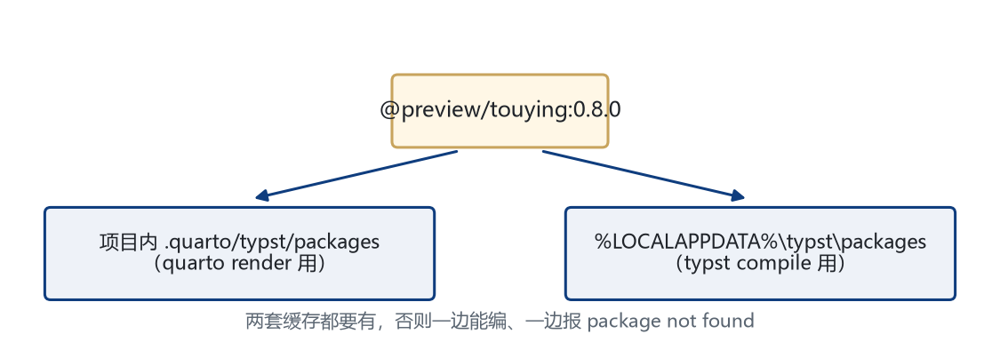{width=100%}
:::

::: {.column width="46%"}
**为什么有两套**

- `quarto render` 用项目内 `.quarto/typst/packages`
- `typst compile` 用 `%LOCALAPPDATA%\typst\packages`

**检查**

```bash
dir .quarto\typst\packages\preview\touying
dir %LOCALAPPDATA%\typst\packages\preview\touying
```

两边版本必须一致。
:::
:::

## 升级的五个坑

::: {.columns}
::: {.column width="48%"}
::: {.pitfall}
**坑 1**：只改 import 就 render，报 `package requires Typst 0.15`。
:::

::: {.pitfall}
**坑 2**：只装了 `%LOCALAPPDATA%`，`quarto render` 找不到包。
:::

::: {.pitfall}
**坑 3**：先升 Touying 再升 Quarto，内置 Typst 不够。
:::
:::

::: {.column width="48%"}
::: {.pitfall}
**坑 4**：忘同步项目内 `.quarto/typst/packages`，本地能编、CI 报错。
:::

::: {.pitfall}
**坑 5**：升级后没跑 `check.py`，页数变了才发现图号重复。
:::

::: {.defbox}
**正确顺序**：升 Quarto → 确认 Typst → 装两套缓存 → 改 import → `check.py`。
:::
:::
:::

## 下载走国内镜像

::: {.columns}
::: {.column width="52%"}
| 源 | 实测 |
|:--|:--|
| GitHub 直连 | 约 400 B/s，连接重置 |
| ghfast / gh-proxy | 几十 KB/s |
| TUNA / USTC | 无 quarto-cli release |
| conda-forge（TUNA） | 有包，速度可用 |
:::

::: {.column width="44%"}
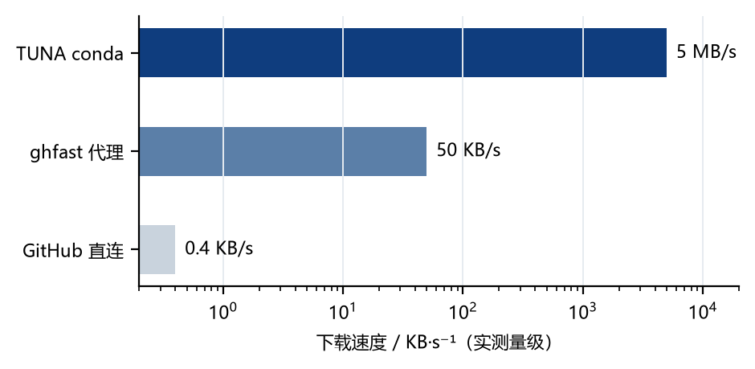{width=100%}

**教训**：下载源本身也是工程环境的一部分，写进 README。
:::
:::

## 校验闭环

::: {.columns}
::: {.column width="54%"}
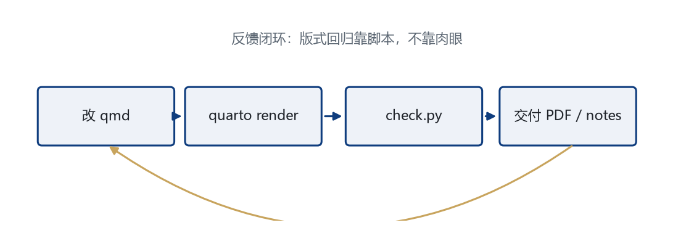{width=100%}
:::

::: {.column width="42%"}
**check.py 查什么**

- 页数、标题越界、导航重叠
- 金线位置、页码基线
- 图号唯一、目录链接数

**参数**

```bash
python scripts/check.py --pdf research.pdf \
  --no-baseline --links --expect-pages 24 24
```
:::
:::

## check.py 在量什么

::: {.columns}
::: {.column width="52%"}
```python
def structural_errors(snapshot):
    for num, m in snapshot["items"].items():
        t, n = m["title"], m["nav"]
        if t[1] < 0:          # 标题顶出页
            errors.append(f"p{num}: clipped")
        if t[2] > n[0] - 6:   # 标题压导航
            errors.append(f"p{num}: overlaps nav")
        if r < t[3] + 0.5:    # 蓝线穿过标题
            errors.append(f"p{num}: rule crosses")
```
:::

::: {.column width="44%"}
**先测量，再断言**

- 每页抽 `title / nav / rule / gold` 的 bbox
- 做 5 条几何断言：越界、重叠、穿线、金线、页码
- 失败直接列页号，版式回归不用肉眼

```text
FAIL (2 issues)
  - p5: title clipped at page top
  - p7: title overlaps nav
```
:::
:::

# 互动与交付 {#sec-05}

<div class="nwpu-part">
<span class="part-meta" data-section="05" data-nav="互动与交付"></span>
<div class="part-watermark">05</div>
<div class="part-label">PART 05</div>
<div class="part-title">互动与交付</div>
<div class="part-rule"></div>
</div>

## 一份源，四种交付

::: {.columns}
::: {.column width="54%"}
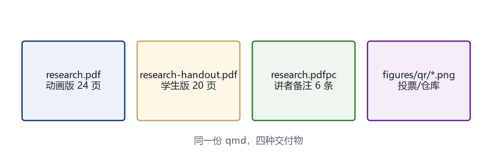{width=100%}
:::

::: {.column width="42%"}
**三条命令生成全部**

```bash
quarto render research.qmd
quarto render research.qmd --profile handout \
  --output research-handout.pdf
python scripts/export_notes.py
```

- 动画版：分步可翻
- handout：步骤合并
- pdfpc：双屏讲稿
:::
:::

## 讲稿是怎么导出的

::: {.columns}
::: {.column width="52%"}
```python
cmd = ["typst", "query", typ,
       "--field", "value", "--one", "<pdfpc-file>"]
data = json.loads(subprocess.run(cmd, ...).stdout)
json.dump(data, open(out, "w"),
          ensure_ascii=False, indent=2)
```
:::

::: {.column width="44%"}
**三步**

- `#speaker-note` 把备注写进 PDF 元数据
- `typst query` 取出 `<pdfpc-file>` 这个 JSON
- 写成 `.pdfpc`，pympress / pdfpc 双屏直接读

**验证**：`pdfpc research.pdfpc` 能列出每页备注即可。
:::
:::

## 课堂 45 分钟怎么排

::: {.columns}
::: {.column width="54%"}
{width=100%}
:::

::: {.column width="42%"}
**每段做什么**

- 导入：抛一个失败案例
- 概念：一页一个结论
- 演示：现场跑一条命令
- 练习：给一个可改的参数
- 小结：回到 checklist
:::
:::

# 实现解剖：代码怎么组织 {#sec-06}

<div class="nwpu-part">
<span class="part-meta" data-section="06" data-nav="实现解剖"></span>
<div class="part-watermark">06</div>
<div class="part-label">PART 06</div>
<div class="part-title">实现解剖：代码怎么组织</div>
<div class="part-rule"></div>
</div>

## 代码结构与分层

::: {.columns}
::: {.column width="54%"}
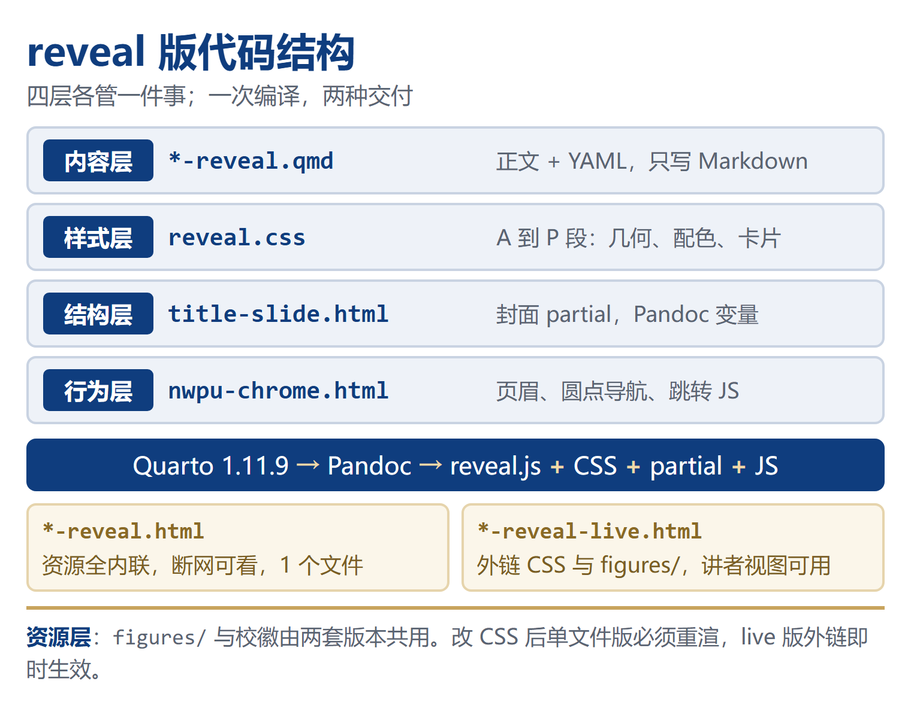{width=100%}
:::

::: {.column width="42%"}
| 文件 | 职责 |
|:--|:--|
| `*-reveal.qmd` | 内容 + YAML |
| `reveal.css` | A 到 P 段全部样式 |
| `title-slide.html` | 封面 partial |
| `nwpu-chrome.html` | 页眉与导航 JS |
| `figures/`、校徽 | 图片资源 |
| 四份 HTML | 交付产物 |

::: {.defbox}
**分层原则**：内容写 qmd，几何写 CSS Grid，结构写 partial，行为写注入 JS，四层互不串。
:::
:::
:::

::: {.notes}
这一章讲网页版自己的实现，与前面 Typst 主线并列。记住四个入口：改文字找 qmd，改线宽圆角找 reveal.css，改封面找 title-slide.html，改页眉导航找 nwpu-chrome.html。
:::

## 渲染管线与双产物

::: {.columns}
::: {.column width="52%"}
```yaml
# 文档顶层，不能写进 format: 块
embed-resources: true
html-math-method: mathml
```

```bash
quarto render slides-reveal.qmd \
  -o slides-reveal.html
quarto render slides-reveal.qmd \
  -M embed-resources:false \
  -M html-math-method:mathjax \
  -o slides-reveal-live.html
```
:::

::: {.column width="44%"}
|  | 单文件版 | live 版 |
|:--|:--|:--|
| CSS / 图片 | 内联 | 外链 |
| 公式 | MathML | MathJax |
| 讲者视图 | 可能失效 | S 键可用 |
| 分发 | 1 个 HTML | 四件套 |

**两个顶层键的原因**：`-M` 只覆盖文档顶层元数据，写进 `format.revealjs` 里会失效。

MathML 在构建期静态生成，断网可看；MathJax 运行时排版，靠联网换功能完整。
:::
:::

::: {.notes}
四件套是 HTML、*_files/、reveal.css、figures/。单文件版把 CSS 与图片全部转成 base64，所以改完 reveal.css 必须重渲才同步；live 版本来就是外链，改完立刻生效，但分发时容易漏带 CSS。
:::

## CSS 分段地图：A 到 P

::: {.columns}
::: {.column width="54%"}
| 段 | 管什么 |
|:--|:--|
| A | 设计令牌、配色、字体栈 |
| B 到 D | 全局排版 / 页眉三列 / 页脚金线 |
| E 到 G | 封面 / 提纲 / PART 分节 |
| H 到 H3 | panel 五种 mode + 格内细分 + 格内媒体 |
| I 到 K | 五类卡片 / 代码 / 表格 |
| L 到 M | 公式 / 图号计数器 |
| N | 打印与 fragment 覆盖 |
| O 到 P | 两栏 / 杂项 / 菜单按钮 |
:::

::: {.column width="44%"}
```css
:root {
  --pt: 1.5202px;   /* 1280 / 842 */
  --y-rule: calc(34.2 * var(--pt));
  --panel-h: calc(380 * var(--pt));
}
```

**一条换算打底**：Typst 设计稿 842×473pt 映射到 reveal 1280×720，所有几何按 pt 原样换算，改一处全局生效。

**一个坑**：`.slides section` 必须保持 `position:absolute`；改成 `relative` 会让所有页进入文档流，当前页被推出视口（曾出现整页空白）。
:::
:::

::: {.notes}
--pt 是整个主题的基准：1pt = 1280/842 px。页眉蓝线 34.2pt、正文起点 47pt、金线 445.47pt、panel 画布 380pt 都从 Typst 原型原样搬过来，所以两套版本的视觉能一一对齐。
:::

## 页眉与导航：JS 在做什么

::: {.columns}
::: {.column width="54%"}
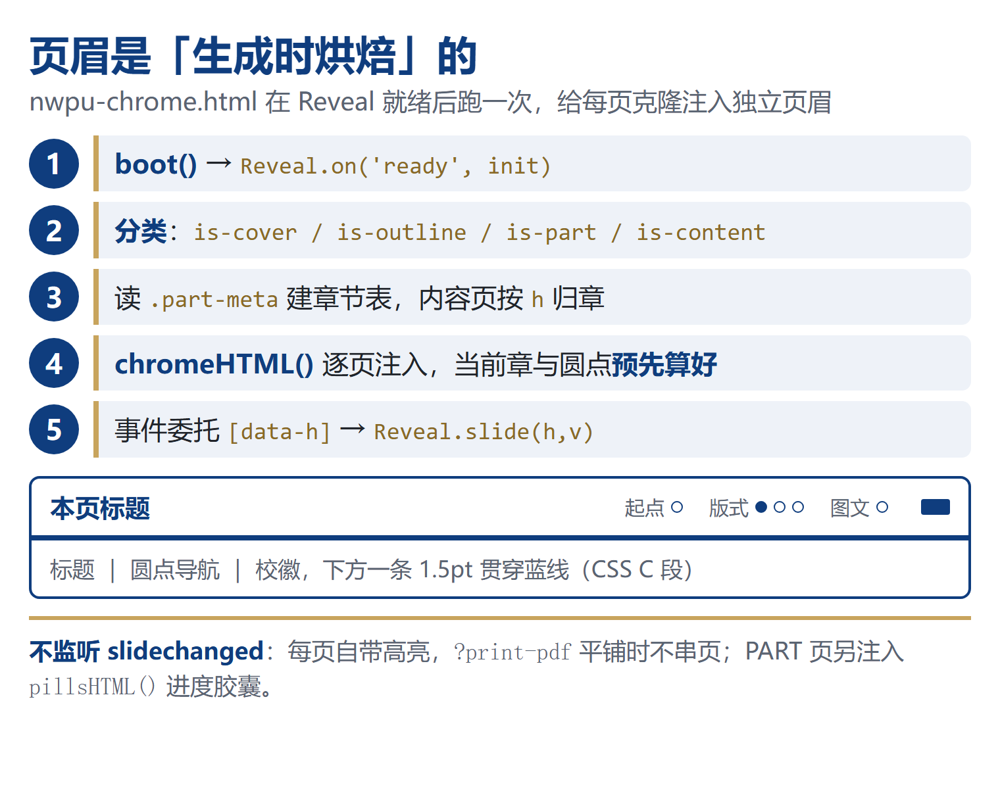{width=100%}
:::

::: {.column width="42%"}
```js
var chapters = parts.map(function (p) {
  var m = p.querySelector('.part-meta');
  return {
    h: indices(p).h,
    num: m.getAttribute('data-section'),
    label: m.getAttribute('data-nav')
  };
});
contents.forEach(function (s) {
  s.insertAdjacentHTML('afterbegin',
    chromeHTML(chapters, ch, dotIdx, title));
});
```

- 四类分页：`is-cover / is-outline / is-part / is-content`
- 高亮**预烘焙**，不监听 `slidechanged`
- 点击走事件委托 `[data-h]` → `Reveal.slide(h, v)`
:::
:::

::: {.notes}
为什么要预烘焙：?print-pdf 会把所有页平铺，如果靠 slidechanged 事件改高亮，平铺时只有一页是对的。给每页克隆注入独立页眉，生成时就把当前章和当前圆点算好，静态截图也正确。章节表来自 PART 页里那行隐藏的 .part-meta，所以增删章节不用改 JS。
:::

## 封面、图号与打印

::: {.columns}
::: {.column width="52%"}
```html
<section id="$idprefix$title-slide"
         data-state="cover">
  <h1 class="cv-title">$title$</h1>
  <div class="cv-band">$date$</div>
</section>
```

```css
.reveal .slides { counter-reset: fig 0; }
figcaption::before {
  counter-increment: fig;
  content: "图 " counter(fig) "　";
}
```
:::

::: {.column width="44%"}
**封面**：`template-partials` 换掉 Quarto 默认封面；`$title$`、`$date$` 是 Pandoc 变量；同心金环用 `::before` / `::after` 画，原生 `h1` 由 CSS 隐藏。

**图号**：计数器挂在 `.slides`，每个 `figcaption::before` 自增一次。改写格子时别增减 `<figure>`，否则编号整体位移；reveal 只渲染当前页，编号随可见页变化，图号只作装饰，别写「见图 N」。

**打印**：`html.print-pdf .fragment { opacity: 1 }` 展开分步，`@page { size: 1280px 720px }` 定尺寸，隐藏圆点导航、保留页码。
:::
:::

::: {.notes}
两个容易忽略的点：一是图号是纯 CSS 计数器，不是 Pandoc 编号，所以任何 figure/figcaption 的增减都会连锁影响后面所有图；二是打印覆盖同时写在 @media print 和 html.print-pdf 下，前者管浏览器另存为 PDF，后者管 reveal 自己的 print-pdf 平铺模式。
:::

## 全部功能 → 实现位置

::: {.columns}
::: {.column width="48%"}
**版式与内容**

| 功能 | 实现位置 |
|:--|:--|
| 封面 | `title-slide.html` + CSS E |
| 三列页眉 / 蓝线 | CSS C |
| 圆点章节导航 | `nwpu-chrome.html` |
| 点击跳转 / PART 胶囊 | 事件委托 + `pillsHTML()` |
| 提纲 / 金线 / 页码 | CSS F / D |
| panel 五种 mode | CSS H |
| 格内细分 | CSS H2 |
| 格内媒体 | CSS H3 + `data-media` |
| 卡片 / 代码 / 表格 / 公式 / 图号 | CSS I 到 M |
:::

::: {.column width="48%"}
**交互与交付**

| 功能 | 实现位置 |
|:--|:--|
| 分步出现 | `::: {.fragment}` |
| 讲者备注 | `::: {.notes}` + S 键 |
| 目录 | `menu: true` + M 键 |
| 打印 PDF | CSS N + `?print-pdf` |
| 单文件版 | `embed-resources: true` |
| live 版 | `-M` 覆盖顶层元数据 |
| 离线公式 | `html-math-method: mathml` |
| 图片 / 二维码 | `figures/` + `<figure>` |
:::
:::

::: {.defbox}
**一句话**：结构交给 fenced div，几何交给 CSS Grid，行为交给注入 JS，内容永远只写 Markdown。
:::

::: {.notes}
这张表可以当排障索引：页眉不对查 CSS C 与 nwpu-chrome.html；格子线不对查 CSS H/H2；图号跳号查 CSS M 与 figure 数量；打印少内容查 CSS N。
:::

## 验证闭环：怎么确认没改坏

::: {.columns}
::: {.column width="52%"}
```js
document.querySelectorAll(
  '.panel .cell[data-split] > .sub'
).forEach(function (e) {
  assert(e.scrollHeight
         <= e.clientHeight + 1);
});

// 1.3.0：格内媒体必须真的装进去
document.querySelectorAll(
  '.panel [data-media]'
).forEach(function (h) {
  assert(getComputedStyle(h).display
         === 'flex');
  var leaf = h.querySelector('img,video');
  if (leaf) assert(leaf.offsetHeight >= 91);
});
```

```bash
chrome --headless --screenshot=p.png \
  "slides-reveal.html#/4/6"
```
:::

::: {.column width="44%"}
**四步**

1. 无头 Chrome 截封面、PART、四宫格、公式、`?print-pdf`
2. DOM 断言：子格 `scrollHeight = clientHeight`
3. `getComputedStyle` 查 `display:grid`、`gap`、`border`
4. live 版与单文件版同页截图比对

::: {.defbox}
**已知限制**：单文件版讲者视图可能失效；`chalkboard` 已关闭；中文破折号会分页；`check.py` 基线只适用 PDF。
:::
:::
:::

::: {.notes}
断言比肉眼可靠：三层 overflow:hidden 会把超长内容静默裁掉，页面看起来完全正常。上一轮 12 个子格全部 scrollHeight 等于 clientHeight，才敢说零裁切。另外 scripts/check.py 量的是 Typst PDF 的 bbox，HTML 版要另用浏览器核对。
:::

# 收尾 {#sec-07}

<div class="nwpu-part">
<span class="part-meta" data-section="07" data-nav="收尾"></span>
<div class="part-watermark">07</div>
<div class="part-label">PART 07</div>
<div class="part-title">收尾</div>
<div class="part-rule"></div>
</div>

## Do / Don't 清单

::: {.columns}
::: {.column width="54%"}
| 推荐 | 避免 |
|:--|:--|
| 图放 raw typst `#figure` | Markdown 图片 `{width=}` |
| 动画放无编号图页 | 带图页写 `. . .` |
| 两套缓存都装包 | 只装 `%LOCALAPPDATA%` |
| 先升 Quarto 再升 Touying | 只改 import 就 render |
| `check.py` 守几何 | 肉眼比对 PDF |
:::

::: {.column width="44%"}
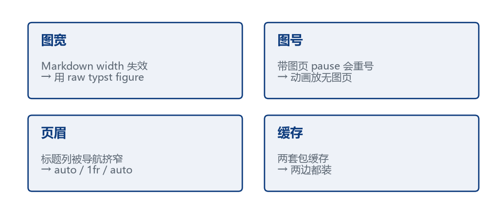{width=100%}
:::
:::

::: {.defbox}
**一句话**：把容易翻车的四件事（图宽、图号、版本、缓存）交给规则和脚本，人只负责内容。
:::

## 带走这张清单

::: {.columns}
::: {.column width="56%"}
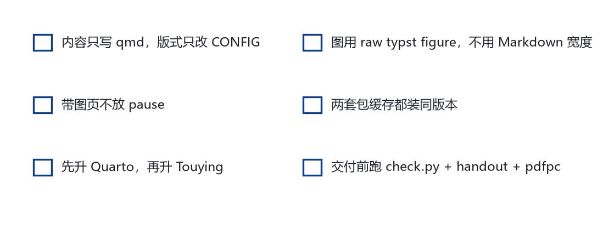{width=100%}
:::

::: {.column width="40%"}
**课后练习**

1. 用 `panel(mode: "3b")` 改一页
2. 给一张图加 `speaker-note`
3. 跑一次 handout + pdfpc
4. 故意写错图宽，看 `check.py` 是否报
:::
:::

## 小结

::: {.columns}
::: {.column width="50%"}
1. Quarto 不直接产 Typst 幻灯，靠扩展桥接
2. 写作仍是 Markdown，结构靠标题切
3. 版式收敛在 `CONFIG`，升级只动 import + 缓存
4. 图宽、图号、页眉、缓存四处最容易翻车
5. 同一份源可出动画版、handout、讲稿、二维码
:::

::: {.column width="46%"}
{width=100%}
:::
:::
