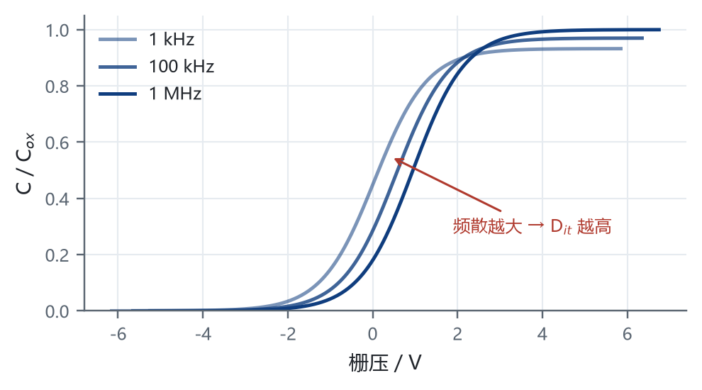
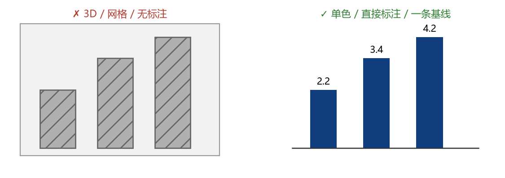

## 汇报提纲 {#outline}

::: nwpu-outline
1.  [第一章：起步](#sec-01)
:::

# 第一章：起步 {#sec-01}

<!-- PART 页：这五个类名是 chrome.html 与 part-contract.lua 的契约。
     别把 part-watermark / part-label / part-title 改成围栏 div ——
     契约过滤器用正则直接从 HTML 取这几处的文本，多包一层 p 就取不到，
     结果是章节编号校验被静默跳过，且不报错。 -->

01

PART 01

第一章：起步

## 普通页：公式、动画与备注

页眉右侧的固定文字来自 YAML 的 `brand-header`，删掉该行即可关闭。

行内公式 $E = mc^2$，块公式：

$$a^2 + b^2 = c^2$$

. . .

这一行会在按空格后出现（fragment）。

::: notes
这是讲者备注，按 S 键打开讲者视图查看。
:::

## Panel 与格内二级细分

::::: {.panel data-mode="3b" style="--px:50%;--py:50%"}
:::: {.cell data-area="a"}
**通栏格**：跨两列，适合放总览或标题。
::::

:::: {.cell data-area="b" data-split="v" style="--sx:40%"}
::: sub
左子格：`data-split="v"` 画竖线。
:::

::: sub
右子格：`--sx:40%` 控制左轨宽度。
:::
::::

:::: {.cell data-area="c"}
普通格：不写 `data-split` 时行为与旧版完全一致。
::::
:::::

::: notes
格子由 CSS Grid 画线：`gap` 透出蓝底，所以线永不切字。一格想再分就写 `data-split="v|h|v3|h3"` 再塞 `.sub`，子格数必须等于轨道数（v/h → 2，v3/h3 → 3）。

这一页不再放 defbox：panel 固定 380pt（约 578px），加上标题和页眉已经把 720px 占满，再塞一段提示框会溢出 58px 被页脚金线盖住。四宫格、图、视频、网页的活例子见下一屏。
:::

## 格内媒体：图 / 视频 / 网页

::::: {.panel data-mode="4" style="--px:50%;--py:50%"}
:::: {.cell data-area="a" data-media="img"}
图 · `data-media="img"`

<figure class="nwpu-fig"><figcaption>一个尺寸都不用写</figcaption></figure>
::::

:::: {.cell data-area="b" data-media="video"}
<video src="figures/media/panel-demo.mp4" controls muted playsinline loop></video>
::::

:::: {.cell data-area="c" data-media="frame" style="--media-ar:16/10"}
<iframe src="figures/media/embed-demo.html" title="格内网页演示"></iframe>
::::

:::: {.cell data-area="d" data-split="h" style="--sy:30%"}
::: {.sub}
半格也能放

`data-split` 再分后，子格同样挂 `data-media`。
:::

::: {.sub data-media="img"}

:::
::::
:::::

::: notes
`data-media` 只干一件事：把「剩余高度」从 grid 轨道一路传到 `img`，末尾 `object-fit:contain` 装箱——不裁、不拉伸、不写数字。

三条硬约定：**必须带值**（裸词 `{data-media}` 会被 Pandoc 当成 class，不报错也不生效）；**与 `data-split` 互斥**（一格要么再分、要么放媒体，同时写时 split 胜出）；**一格一媒体**。

iframe 是独立浏览上下文，Chrome 不按 `object-fit` 缩放它的内容：这里只保证盒子不出界、比例可控（`--media-ar`），页面内部该出滚动条还是出。这是物理上限，不要承诺 contain。
:::

## 图题自动编号

<figure class="nwpu-fig">

<figcaption>图题会由 CSS 计数器自动加上「图 N」前缀</figcaption>

</figure>

::: defbox
**提示**：图号是装饰性编号，reveal 只渲染当前页时可能重复，正文里不要写「见图 N」。
:::
